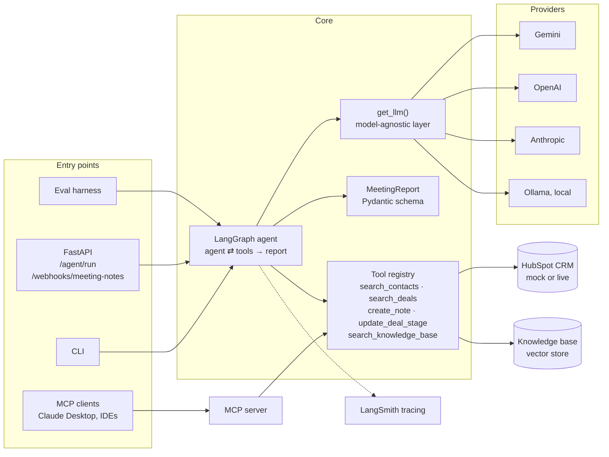
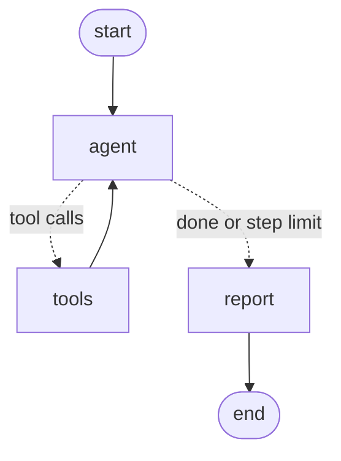

# Mini Agent Stack

[](https://github.com/py3de/mini-agent-stack/actions/workflows/tests.yml)

**A model-agnostic LangChain / LangGraph reference stack for internal AI tools.**

Companies that use LLMs across many internal tools often end up with every tool wired up differently:
different SDKs, different prompts, no shared tracing, no way to compare models. This project is a
small version of the alternative: **one shared foundation** that every tool is built on.

The demo tool is a **meeting-notes → CRM agent**: paste raw notes from a customer call, and the agent
finds the contact and deal in HubSpot, logs a meeting note, moves the deal stage if the call changed
it, looks up answers to the customer's open questions in a knowledge base (RAG), and returns a
validated, structured report with a follow-up email.

| What | How |
|---|---|
| Model-agnostic LLM layer | One `get_llm()` for Gemini, OpenAI, Anthropic and Ollama, switched by config |
| Agent | Explicit LangGraph `StateGraph`: tool calling loop + structured-output node |
| Structured outputs | Pydantic `MeetingReport`, identical across providers |
| Tools | HubSpot CRM tools (mock CRM by default, real HubSpot API with one env var) |
| RAG | Markdown knowledge base, section-level chunks, vector store, model-agnostic embeddings |
| MCP | The same tools exposed as an MCP server, written once and reused |
| API / webhooks | FastAPI with a secret-protected webhook for external systems |
| Resilience | Automatic fallback models plus retries with backoff for overload / rate-limit errors |
| Tracing | LangSmith, enabled with environment variables |
| Evals | Same test cases run across providers, scored on what actually changed in the CRM |
| Tests | Full agent runs tested with a scripted fake model, no API key needed |

## Architecture



The agent graph itself:



## Quickstart

```bash
git clone https://github.com/py3de/mini-agent-stack.git
cd mini-agent-stack
python -m venv .venv && source .venv/bin/activate   # Windows: .venv\Scripts\activate
pip install -e ".[dev]"
cp .env.example .env
```

Add **one** API key to `.env`. The cheapest way to start is a free Gemini key from
[Google AI Studio](https://aistudio.google.com/apikey), or install [Ollama](https://ollama.com) and run
`ollama pull llama3.1` (no key needed). Model names change often, so you can override them with
`MODEL_GOOGLE`, `MODEL_OPENAI` and so on.

```bash
agent-stack providers                                  # which providers are ready
agent-stack run --notes-file examples/nordwerk.txt     # run the agent on the default provider
agent-stack run --provider ollama --notes-file examples/nordwerk.txt
pytest                                                 # tests run without any API key
```

HubSpot runs in **mock mode** by default (an in-memory CRM with demo contacts and deals). To use a
real account, create a free HubSpot developer test account with a private app that has CRM
read/write scopes, then set `HUBSPOT_MODE=live` and `HUBSPOT_ACCESS_TOKEN`.

## Using it

### HTTP API and webhook

```bash
uvicorn agent_stack.api:app --reload
```

```bash
curl -X POST localhost:8000/agent/run \
  -H "Content-Type: application/json" \
  -d '{"notes": "Call with Jonas Weber (AlpenTech): they will stay with their current provider.", "provider": "google"}'

# External systems (e.g. a meeting recorder) call the webhook with a shared secret:
curl -X POST localhost:8000/webhooks/meeting-notes \
  -H "X-Webhook-Secret: change-me" -H "Content-Type: application/json" \
  -d '{"notes": "..."}'
```

Interactive docs are available at `http://localhost:8000/docs`.

### MCP server

The CRM tools are also available to any MCP client. For Claude Desktop, add this to
`claude_desktop_config.json`:

```json
{
  "mcpServers": {
    "mini-agent-stack-crm": {
      "command": "/absolute/path/to/mini-agent-stack/.venv/bin/python",
      "args": ["-m", "agent_stack.mcp_server"]
    }
  }
}
```

### Knowledge base (RAG)

`knowledge/*.md` holds company documents (security & hosting, services, contracts & pricing). Each
`##` section becomes one chunk, so every retrieved result is a self-contained answer with a clear
source like `security-and-hosting.md > Data residency`. When meeting notes contain a customer
question ("do you host in the EU?"), the agent calls `search_knowledge_base` and the follow-up email
answers it with facts instead of guesses.

Embeddings are model-agnostic too (`EMBEDDINGS_PROVIDER` = google, openai or ollama). The vector store
is LangChain's `InMemoryVectorStore`, rebuilt on start; moving to pgvector / Supabase only changes
`build_vector_store()` in `rag.py`. To use your own documents, drop markdown files into `knowledge/`.

### Tracing with LangSmith

Set `LANGSMITH_TRACING=true` and `LANGSMITH_API_KEY` in `.env`. Every run, LLM call and tool call
then shows up in LangSmith under the project `mini-agent-stack`, tagged with the provider.

### Evals: comparing models

```bash
python evals/run_evals.py                          # every provider with a key
python evals/run_evals.py --providers google ollama
```

Each case in `evals/cases.json` resets the CRM, runs the agent and then checks **what actually
happened in the CRM**, not just what the model says it did:

- **Schema:** a valid `MeetingReport` came back
- **Note:** a note was logged on the right contact (and nothing for unknown contacts)
- **Stage:** the right deal moved to the right stage, and no other deal was touched
- **IDs:** the report's deal ID matches reality (no invented IDs)
- **KB:** the knowledge base was searched when the customer asked a question

Results, including latency and number of tool calls, are written to `evals/results/results.md`.

<!-- After running the evals, paste evals/results/results.md here and add 2-3 sentences on the trade-offs you saw. -->

## Adding a new tool

1. Write a function with `@tool` in a module under `src/agent_stack/tools/`. The docstring is what
   the model reads, so describe **when** to use the tool, not only what it does.
2. Return errors as text instead of raising, so the model can recover.
3. Add it to a toolset in `src/agent_stack/tools/__init__.py`.

The agent, the API and the MCP server pick it up automatically. Add an eval case if the tool
changes data.

## Design decisions

- **One LLM entry point.** Tools never import a provider SDK. `get_llm()` uses LangChain's
  `init_chat_model`, so switching or adding a provider is configuration, and every model gets
  tool calling and structured output through the same interface.
- **An explicit `StateGraph` instead of a prebuilt agent.** The loop, the step limit and the final
  structured-output node are visible and testable. The step limit protects against runaway tool loops.
- **Separate structured-output step.** Mixing "call tools" and "return JSON" in one call is fragile on
  some providers. A dedicated `report` node makes the output schema reliable on all of them.
- **Write tools once, use them everywhere.** The MCP server wraps the existing LangChain tools instead of
  reimplementing them, so the agent and MCP clients can never drift apart.
- **Evals check side effects, not claims.** A model can say "I updated the deal" without doing it. The
  evals inspect the CRM state after each run.
- **Resilience in two layers.** Each model call first falls back to backup models (`LLM_FALLBACKS`), and
  graph nodes retry transient errors (503 overload, 429 rate limits) with exponential backoff. Permanent
  errors such as a wrong key or model name fail fast with a readable message instead of being retried.
  Provider SDKs are set to fail fast (1 retry, 60 s timeout) so an overloaded model hands over to the
  backup in seconds. With SDK defaults, one overloaded run took over 6 minutes.
- **Section-level chunking for RAG.** Company documents are short and well structured, so one chunk per
  `##` section keeps answers complete and sources readable. Fixed-size chunking would cut answers in half.
- **Mock-first.** The mock CRM and the scripted fake model mean everything can be developed and tested
  without accounts, keys or cost.

## Project structure

```
src/agent_stack/
  llm.py             model-agnostic LLM layer (provider registry)
  agent.py           LangGraph agent: agent ⇄ tools → report
  schemas.py         structured outputs (MeetingReport)
  rag.py             knowledge base: chunking, embeddings, vector store
  tools/             tool registry, CRM tools, knowledge-base tool
  hubspot_client.py  mock and live HubSpot backends
  api.py             FastAPI app and webhook
  mcp_server.py      MCP server exposing the same tools
  cli.py             command line interface
evals/               eval cases and the provider comparison harness
tests/               tests with a scripted fake model (no API keys)
examples/            sample meeting notes
knowledge/           markdown documents for the knowledge base (RAG)
```

## Roadmap

- [x] RAG over a knowledge base (vector store) so the agent can answer customer questions in follow-up emails
- [ ] Persist runs and reports in Supabase / Postgres
- [ ] Small Lovable front end on top of the API
- [ ] Human-in-the-loop approval before write actions (LangGraph interrupts)
- [ ] More eval cases and LLM-as-judge scoring for the summary and email quality

## License

MIT
